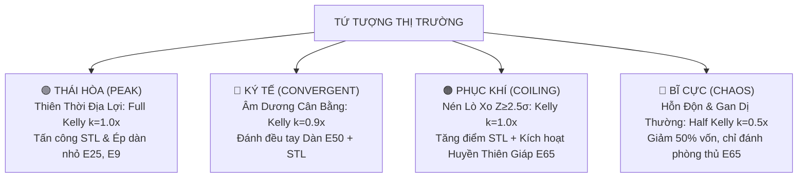

# CẨM NANG VẬN HÀNH ĐỊNH LƯỢNG HÀNG NGÀY: ĐẠO DỊCH HUYỀN CƠ PHÁP (TIDS QUANTUM V2.0)
> **Hệ thống Định lượng & Tối ưu hóa Danh mục Đầu tư Xổ số Kiến thiết Miền Bắc (XSMB)**  
> *Triết lý Đạo Dịch Huyền Cơ - Toán học Đa tạp Tô-pô & Trường Thế Năng Hiệu Dụng $V_{\text{eff}}$ kết hợp Mô hình Black-Scholes-Merton (BSM) Đa nhân tố.*

---

## MỤC LỤC
1. [HỆ THỐNG THUẬT NGỮ ĐẠO DỊCH - KINH DỊCH CHUẨN HÓA](#1-hệ-thống-thuật-ngữ-đạo-dịch---kinh-dịch-chuẩn-hóa)
2. [BẢNG LỆNH TẮT VẬN HÀNH SIÊU NGẮN (CHEATSHEET HÀNG NGÀY)](#2-bảng-lệnh-tắt-vận-hành-siêu-ngắn-cheatsheet-hàng-ngày)
3. [TỨ TƯỢNG THỊ TRƯỜNG & CHIẾN LƯỢC ĐIỀU BIẾN TỰ ĐỘNG](#3-tứ-tượng-thị-trường--chiến-lược-điều-biến-tự-động)
4. [TAM TÀI DANH MỤC & PHÂN BỔ VỐN TỰ CÂN BẰNG KELLY](#4-tam-tài-danh-mục--phân-bổ-vốn-tự-cân-bằng-kelly)
5. [CỬU CUNG THẦN TRẬN: 7 CẤP ĐỘ DÀN ĐỀ ĐẶC BIỆT ($E_1 \rightarrow E_{65}$)](#5-cửu-cung-thần-trận-7-cấp-độ-dàn-đề-đặc-biệt-e_1-rightarrow-e_65)
6. [QUY TRÌNH VẬN HÀNH CHUẨN 3 BƯỚC MỖI NGÀY](#6-quy-trình-vận-hành-chuẩn-3-bước-mỗi-ngày)
7. [KỶ LUẬT THÉP VÀ NGUYÊN TẮC BẢO TOÀN VỐN](#7-kỷ-luật-thép-và-nguyên-tắc-bảo-toàn-vốn)

---

## 1. HỆ THỐNG THUẬT NGỮ ĐẠO DỊCH - KINH DỊCH CHUẨN HÓA

| Thuật ngữ Đạo Dịch | Tên Kỹ Thuật Toán Học | Ý Nghĩa & Bản Chất Hệ Thống |
| :--- | :--- | :--- |
| **ĐẠO DỊCH HUYỀN CƠ PHÁP** | TIDS Quantum BSM Multi-Factor | Phương pháp luận hợp nhất quy luật vận động tuần hoàn của vũ trụ và toán học định lượng tập trung |
| **THIÊN CƠ ĐỘ (QCI)** | Quantum Confidence Index (0-100%) | Thước đo mức độ hiển lộ của cơ trời; định lượng độ tự tin và tỷ lệ thắng kỳ vọng của danh mục |
| **TRƯỜNG THẾ NĂNG HIỆU DỤNG** | Effective Potential Energy $V_{\text{eff}}(s)$ | Lực hút xác suất tổng hợp kéo các con số về trạng thái cân bằng |
| **QUY NGUYÊN TRẬN** | BSM Coiling Regression Cluster | 10 số đáy thế năng cụm nén BSM vĩ mô khi $Z \ge 2.5\sigma$ (Chẵn/Lẻ hoặc Tài/Xỉu) |
| **HUYỀN THIÊN GIÁP ($E_{65}$)** | Dynamic Shield Barrier 65 numbers | Dàn 65 số đóng vai trò tấm giáp hộ thân, bảo toàn vốn 100% khi thị trường nén hoặc nhiễu loạn |
| **ĐẠI DIỄN THẦN TRẬN ($E_{50}$)** | Equilibrium Level Set 50 numbers | Dàn 50 số cân bằng xác suất cổ điển (50 số tự nhiên) |
| **HÀ ĐỒ TỰ NHIÊN ($E_{25}$)** | Hà Đồ Core Matrix 25 numbers | Dàn 25 số lõi ($5 \text{ đầu} \times 5 \text{ đuôi}$) mang tính sinh thành |
| **CỬU CUNG LẠC THƯ ($E_9$)** | Lạc Thư Kernel 9 numbers | Dàn 9 số hạt nhân trọng tâm ($3 \text{ đầu} \times 3 \text{ đuôi}$) bứt phá lợi nhuận |
| **TỨ TƯỢNG HỘI TỤ ($E_4$)** | Tứ Thủ Đề (4 numbers) | 4 con số tinh tuyển hội tụ năng lượng mạnh nhất |
| **LƯỠNG NGHI ĐỒNG QUY ($E_2$)** | Song Thủ Đề (2 numbers) | 2 con số âm dương giao hòa |
| **THÁI CỰC NHẤT ĐIỂM ($E_1$)** | Bạch Thủ Đề (1 number) | 1 con số duy nhất hội tụ đỉnh cao thế năng |

---

## 2. BẢNG LỆNH TẮT VẬN HÀNH SIÊU NGẮN (CHEATSHEET HÀNG NGÀY)

Bạn có thể gõ trực tiếp trong Terminal (CMD hoặc PowerShell) các lệnh ngắn gọn:

| Lệnh tắt mới | Lệnh nguyên bản tương đương | Ý nghĩa & Mục đích sử dụng |
| :--- | :--- | :--- |
| **`share.bat`** | `.\tids.bat share` | **CHIA SẺ ĐƯỜNG LINK ONLINE MIỄN PHÍ**: Tự động tạo link HTTPS công khai toàn cầu (Cloudflare Tunnel) để gửi cho bất kỳ ai trải nghiệm thử trên điện thoại (4G/Wi-Fi) mà không cần cài đặt. |
| **`app.bat`** hoặc **`web.bat`** | `.\tids.bat web 5050` | **KHỞI ĐỘNG WEB APP (GIAO DIỆN ĐỒ HỌA PWA)**: Tự động mở trình duyệt tại `http://localhost:5050`, hỗ trợ 100% tính năng, nhập kết quả bằng dán văn bản và 1-Click Copy Zalo/Sheet. |
| **`p`** | `.\tids.bat predict 500000` | Xuất Dự báo toàn diện hôm nay theo ngân sách chuẩn **500.000 VNĐ** |
| **`p 500k`** | `.\tids.bat predict 500000` | Xuất Dự báo toàn diện theo mức vốn chỉ định (hỗ trợ `500k`, `1tr`, `300k`, `1.5m`...) |
| **`s`** hoặc **`s 500k`** | `.\tids.bat sheet 500000` | **Bảng Tam Tài Google Sheet**: 1-Click Copy/Paste vào Google Sheet / Excel cực chuẩn |
| **`today`** hoặc **`today 500k`** | `p 500k` + `s 500k` | Xuất đồng thời cả Dự báo chi tiết lẫn Bảng dữ liệu Copy vào Google Sheet |
| **`d50`** | `.\tids.bat d50test 100` | Kiểm định hiệu quả 100 ngày gần nhất của Dàn Đề Đại Diễn $E_{50}$ |
| **`d65`** | `.\tids.bat d65test 100` | Kiểm định hiệu quả 100 ngày gần nhất của Dàn Đề Huyền Thiên Giáp $E_{65}$ |
| **`regime`** | `.\tids.bat regimetest 100` | Đối soát phân loại Tứ Tượng Thị Trường trên 100 kỳ lịch sử |

> [!TIP]
> **Quy ước đơn vị tiền tệ linh hoạt**: Bạn có thể nhập `500k`, `500`, `1tr`, `1.2m`, `1200k`, `1500000`... Hệ thống đều tự động nhận diện chính xác 100%.

---

## 3. TỨ TƯỢNG THỊ TRƯỜNG & CHIẾN LƯỢC ĐIỀU BIẾN TỰ ĐỘNG

Dựa trên 4 thước đo vật lý toán học (Entropy $H$, Phổ $\gamma$, Nén $Z$-Score BSM, Quán tính $M$), hệ thống tự động nhận diện trạng thái thời khí và điều chỉnh mức cược:



---

## 4. TAM TÀI DANH MỤC & PHÂN BỔ VỐN TỰ CÂN BẰNG KELLY

Ngân sách mỗi ngày được phân bổ chặt chẽ theo cấu trúc **Tam Tài Tương Hỗ**:

1. **Trục 1: ĐỊA LỢI (+EV Cash Engine - ~50% ngân sách)**:
   - **Song Thủ Lô (STL)**: Động cơ dòng tiền dương (xác suất trúng $\ge 50\%$, tỷ lệ ăn 1:99).
   - **Cặp Xiên 2 STL**: Đòn bẩy tỷ lệ ăn 1:16.5 để khuếch đại lợi nhuận.
2. **Trục 2: NHÂN HÒA (Hộ Thân & Bảo Vệ Vốn - ~35% ngân sách)**:
   - **Lô Lót Tứ Thủ**: 2 số lót phòng thủ bảo vệ danh mục (nâng tỷ lệ ăn Lô lên 73.33%).
   - **Huyền Thiên Giáp ($E_{65}$)**: Kích hoạt khi thị trường Phục Khí (Coiling) hoặc Bĩ Cực (Chaos).
   - **Đại Diễn Thần Trận ($E_{50}$)**: Đánh đều tay bảo hiểm tiền đề.
   - **Cửu Cung Lạc Thư ($E_9$) & Tứ Tượng ($E_4$)**: Cược thêm tăng cấp để bứt phá.
3. **Trục 3: THIÊN THỜI (Đòn Bẩy Đột Biến - ~15% ngân sách)**:
   - **Dàn 3 Càng Tinh Tuyển 12 số (3D)**: Tỷ lệ ăn 1:960 mang lại cú đột biến lợi nhuận cực lớn.

---

## 5. CỬU CUNG THẦN TRẬN: 7 CẤP ĐỘ DÀN ĐỀ ĐẶC BIỆT ($E_1 \rightarrow E_{65}$)

```
                      [E1] Thái Cực Nhất Điểm (1 số)  - Ăn 1:99
                     [E2] Lưỡng Nghi Đồng Quy (2 số)  - Âm Dương cân bằng
                    [E4] Tứ Tượng Hội Tụ (4 số)       - Hạt nhân động lượng
                   [E9] Cửu Cung Lạc Thư (9 số)       - Trọng tâm bứt phá
                 [E25] Hà Đồ Tự Nhiên (25 số)         - Lõi sinh thành 5x5
               [E50] Đại Diễn Thần Trận (50 số)       - Cân bằng xác suất
             [E65] HUYỀN THIÊN GIÁP (65 số)           - TẤM GIÁP BẢO VỆ VỐN TUYỆT ĐỐI
```

---

## 6. QUY TRÌNH VẬN HÀNH CHUẨN 3 BƯỚC MỖI NGÀY

### Bước 1: Trích xuất Dự báo & Lấy Bảng Sheet (Trước 16h30)
- Mở terminal gõ:
  ```cmd
  s 500k
  ```
- Quét chọn khối TSV, ấn `Ctrl + C` và dán `Ctrl + V` vào ô `A1` của Google Sheet hoặc Excel. Toàn bộ tiền cược và danh sách số được tự động phân bổ hoàn hảo.

### Bước 2: Đặt Cược Đúng Kỷ Luật
- Đánh đúng các con số và đúng số tiền đã được hệ thống tính toán (không tự ý nâng cược hay bỏ số).

### Bước 3: Sau 18h30 - Đối soát và Tích lũy
- Đối soát kết quả mở thưởng. Mọi dữ liệu kết quả mới được lưu vào CSDL để tái hiệu chỉnh thế năng cho ngày kế tiếp.

---

## 7. KỶ LUẬT THÉP VÀ NGUYÊN TẮC BẢO TOÀN VỐN
1. **Tuyệt đối không gấp thếp**: Hệ thống vận hành theo chu kỳ kỳ vọng dương ($+EV$). Thắng không tham tăng vọt vốn, thua không tất tay.
2. **Tuân thủ Cầu dao bảo vệ (Circuit Breaker)**: Khi thị trường rơi vào trạng thái 🔴 **Bĩ Cực**, tự động tuân thủ mức cược **Half-Kelly** để bảo vệ 75% thành quả tích lũy.
3. **Giữ trọn bộ Huyền Thiên Giáp**: Trong những ngày lò xo nén mạnh, tấm giáp $E_{65}$ là chốt chặn sinh tử giúp danh mục thu hồi vốn an toàn.
